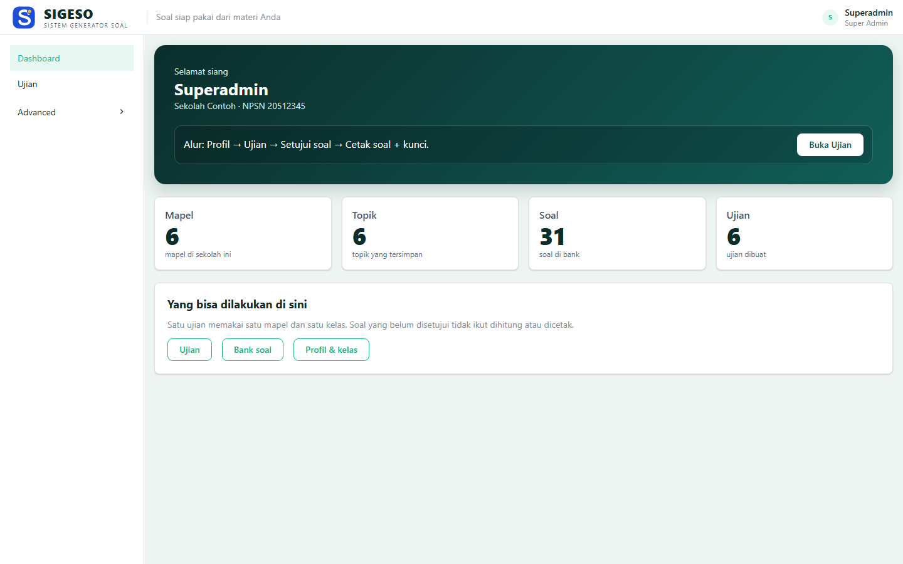
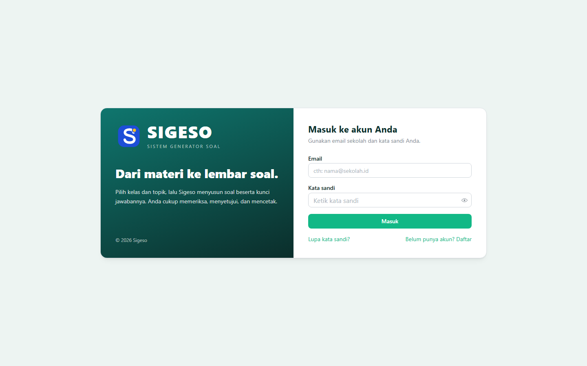
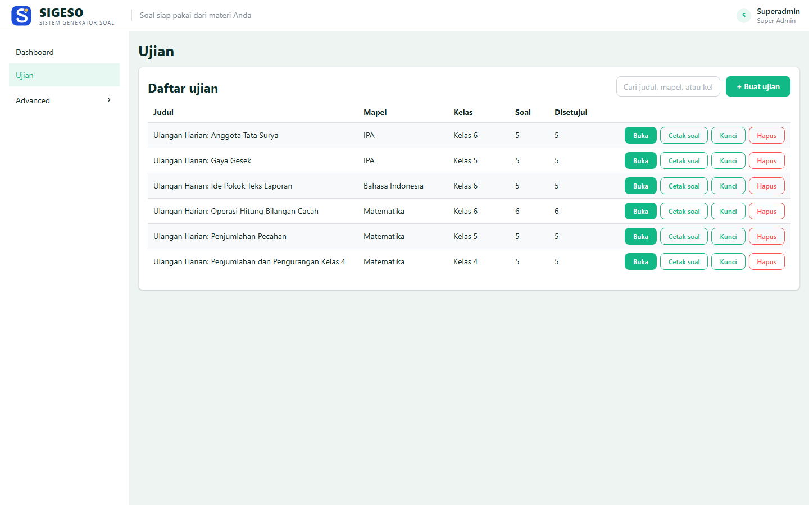
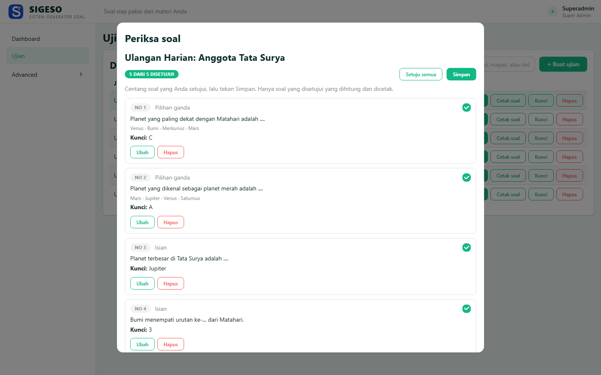
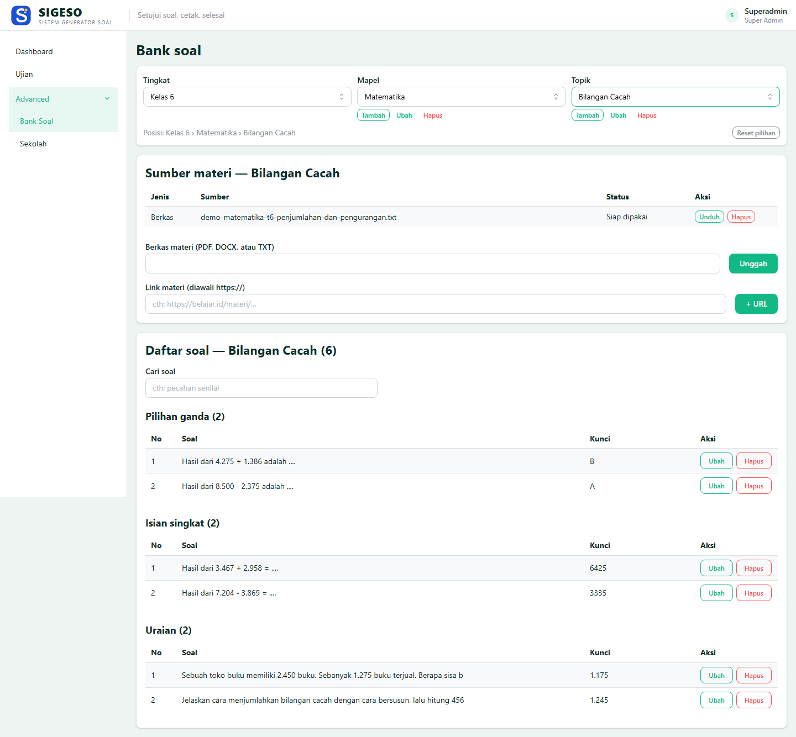
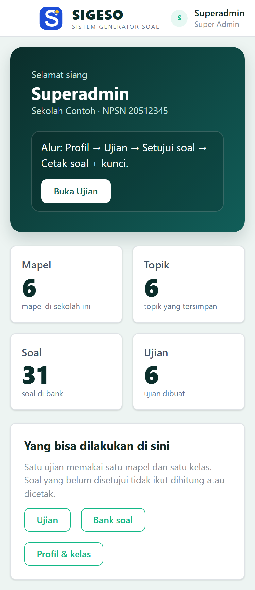

# Sigeso — Sistem Generator Soal

Aplikasi web untuk guru: pilih kelas dan topik, ambil soal dari materi yang sudah
diunggah, periksa, lalu cetak lembar soal beserta kunci jawabannya. Satu ujian =
satu mapel + satu kelas, satu lembar per kelas.



## Fitur

- **Bank soal per topik** — materi (PDF/DOCX/TXT atau tautan) dan soal disimpan per
  topik, jadi bisa dipakai ulang di ujian berikutnya.
- **Buat ujian** — pilih mapel, kelas, dan jumlah soal per jenis (pilihan ganda,
  isian, uraian). Soal bisa dibuat otomatis dari materi, lalu disunting manual.
- **Setujui sebelum cetak** — hanya soal yang dicentang yang ikut dihitung dan
  dicetak. Soal yang belum disetujui tetap tersimpan di bank soal.
- **Cetak soal + kunci** — kop sekolah otomatis, ukuran A4 atau F4, satu lembar
  per kelas. Kunci jawaban dicetak terpisah.
- **Sekolah & pengguna** — data sekolah (NPSN, alamat, kop), akun guru, dan kelas
  per tahun ajaran dikelola dari aplikasi.
- **Responsif** — dipakai nyaman di ponsel maupun laptop.

## Alur kerja

1. **Profil & kelas** — lengkapi data sekolah dan kelas yang diajar.
2. **Bank soal** — pilih tingkat › mapel › topik, unggah materi, lalu susun atau
   buat soal.
3. **Ujian** — buat ujian, periksa soalnya, setujui, lalu cetak soal dan kunci.

## Tangkapan layar

| Masuk | Ujian |
| --- | --- |
|  |  |

| Periksa & setujui soal | Bank soal per topik |
| --- | --- |
|  |  |

<p>
  
</p>

## Stack

React 18 · Vite 5 · Mantine 8 · axios · react-router. Warna dan jarak diatur lewat
CSS variable sendiri di atas komponen Mantine.

Backend (Express + PostgreSQL + Typst + Pandoc) ada di repo terpisah:
**[sigeso-be](https://github.com/SyahidanNJ/sigeso-be)**.

## Coba demo (lokal)

Butuh Node 20+, Docker, dan [Typst](https://typst.app/) + [Pandoc](https://pandoc.org/)
untuk fitur cetak.

```bash
# 1. backend + database
git clone https://github.com/SyahidanNJ/sigeso-be.git
cd sigeso-be
copy .env.example .env      # isi JWT_SECRET dan LLM_API_KEY
docker compose up -d db
npm install && npm run migrate && npm run seed && npm run seed:demo
npm run dev                 # http://localhost:3001

# 2. frontend (terminal lain)
git clone https://github.com/SyahidanNJ/sigeso-fe.git
cd sigeso-fe
copy .env.example .env
npm install && npm run dev  # http://localhost:5173
```

Masuk dengan akun seed: **admin@sigeso.local** / **ganti-password-ini**
(bisa diganti lewat `SEED_EMAIL` dan `SEED_PASSWORD` sebelum `npm run seed`).

`seed:demo` mengisi 3 kelas, 6 mapel, materi beserta soal, dan 6 ujian siap
cetak — cukup untuk mencoba seluruh alur tanpa menyiapkan data sendiri.

## Jalan lokal (tanpa data demo)

1. `copy .env.example .env` — default `VITE_API_URL=http://localhost:3001/api/v1`.
2. `npm install` → `npm run dev` → buka http://localhost:5173.
3. Backend harus jalan lebih dulu. Login di `/login`, token disimpan di
   `localStorage`.
4. `npm run build` untuk bundel produksi (`dist/`).

## Struktur

```
src/
  pages/        Dashboard, Ujian, Soal (bank soal + materi), Sekolah, Profil, Pengguna
  components/   Layout, Modal, PemilihTopik, Popup (toast), Kosong, ErrorBoundary
  lib/          api (axios + penanganan galat), helper unduhan
```
